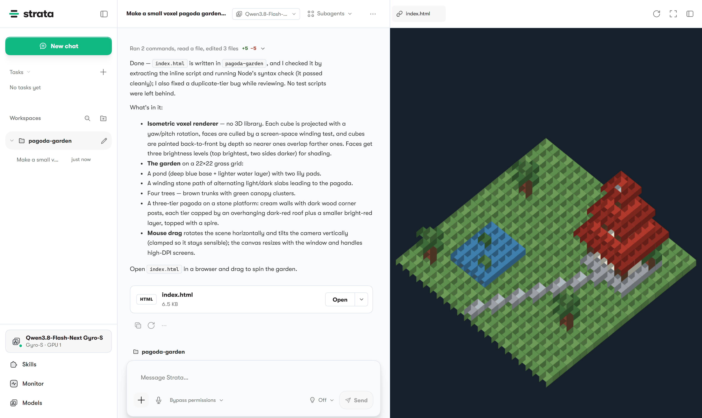

<p align="center"></p>

<h1 align="center">Strata-Cascade</h1>

<p align="center"><b>Run a 125-billion-parameter AI model FASTER on a 32 GB RAM, 16 GB VRAM PC and possibly smaller - even when its experts do not fit in RAM.</b></p>

<p align="center">
  
  
  
  
  
  
</p>

Strata-Cascade is a fork of **[Niko1221/Strata](https://github.com/Niko1221/Strata)**. Upstream already streams a
model too big for your RAM from the SSD; this fork goes further and **uses every fast place at once** - both graphics
cards, a page-locked slice of system RAM, and the SSD - so a machine whose RAM cannot hold the experts keeps
generating at 128K context instead of collapsing into the page file.

> [!IMPORTANT]
> Everything upstream already does - the installer, the app, the API, every model size, AMD and multi-GPU support -
> is **unchanged**. This fork only adds the cascade. If you already run upstream Strata, you can keep your existing
> files: **[see below](#already-run-upstream-reuse-your-files)**.

## What this fork solves

A 125B model's experts are ~24 GB in [Qwen3.8-Flash-Next IQ3_XXS](https://huggingface.co/ISTA-DASLab/Qwen3.8-Flash-Next-GSQ-RCO-GGUF/tree/main/IQ3_XXS).
On a 32 GB PC, upstream must either keep them in RAM (no room) or stream every miss from the SSD - so the experts
either do not fit or the answer stalls on the disk. That is the exact case this fork fixes:

- **Every tier at once.** The experts are split across VRAM, a page-locked slice of RAM and the SSD - and, with a
  second card present, a helper cache that upstream **refuses to combine with the RAM tier at all**.
- **RAM that stays locked.** The hottest remaining experts live in a **page-locked budget**, so throughput stops
  depending on whether the OS file cache happens to be warm.
- **The SSD off the critical path.** Cold experts stream **ahead of the CPU**, a ring of reads in flight, instead of
  blocking on each miss.
- **A machine that stays usable.** The optional **memory guard** makes the engine the cheapest victim when RAM runs
  short, instead of paging *your* apps to a slow disk. Turning that churn into clean, file-backed pages it can drop
  rather than write out **could also mean less SSD wear** (how much depends on your system and what else is running).

## Why it runs faster

**What this build is:** upstream Strata **v0.2.6** (`origin/main` `4b9e05a2`, engine 0.1.51) plus the cascade port. The
measurements below were taken on **v0.1.39** - the base that isolates the fork - and re-confirmed on 0.1.41 and 0.1.43;
they were not taken on this base. Two ideas do the work, and both show up as raw numbers (same PC, same model,
same context - full method in [`STRATA-CASCADE.md`](STRATA-CASCADE.md)):

**Test rig:** AMD Ryzen 7 5800X, 32 GB DDR4-3600, RTX 5060 Ti 16 GB + RTX 3060 12 GB (PCIe 4.0 x8/x8),
SK hynix P41 2 TB (PCIe 4.0) SSD, Windows 11.

| What changed (upstream v0.1.39) | Stock upstream | Strata-Cascade | |
| --- | ---: | ---: | --- |
| **Decode** - writes answers | 42.5 t/s | **51.8 t/s** | **1.2x** |
| **Prefill** - reads your prompt | 253 t/s | **900 t/s** | **3.6x** |

The cascade's win is not the cache hit rate: upstream's newer cache path (`--remote-expert-opt`, on in the stock
arm) brings stock to the same ~87% (see **Results**). It is **keeping the SSD reads in flight** and **spending
every tier once**:

- **Prefetch, don't stall.** A ring of up to ~48 SSD reads stays in flight while the GPU computes the previous
  layer. Upstream beside a helper reads each miss synchronously - which is why its prompt reading stalls at 253 t/s.
- **Spend every tier once.** `settle` sorts each expert into exactly one of VRAM / pinned RAM / SSD, so no expert is
  duplicated on a card and in RAM, and the pinned budget goes only to blobs *no* GPU computes.

## Results

**Qwen3.8-Flash-Next IQ3_XXS, 128K context** (8-bit KV), 32K prompt / 5K reply,
vision on. The headline arms are fresh builds of the same upstream base, **v0.1.39** (`origin/main` `6f32ec0`) - the
cascade was re-confirmed on **v0.1.41** - one
run each, on the same PC (AMD Ryzen 7 5800X, 32 GB DDR4-3600, RTX 5060 Ti 16 GB + RTX 3060 12 GB over PCIe 4.0 x8/x8,
SK hynix P41 2 TB SSD, Windows 11). The model is ISTA-DASLab's [IQ3_XXS quant](https://huggingface.co/ISTA-DASLab/Qwen3.8-Flash-Next-GSQ-RCO-GGUF/tree/main/IQ3_XXS)
of [Qwen3.8-Flash-Next](https://huggingface.co/Qwen/Qwen3.8-Flash-Next) - the exact one setup downloads:

| Config | Decode | Prefill | Cache hit |
| --- | ---: | ---: | ---: |
| Upstream, dual-GPU (`--mmap-experts` + CUDA1 helper + `--remote-expert-opt`) | 42.5 t/s | 252.9 t/s | 87.4% |
| **Strata-Cascade, 2 cards + memory guard** | **51.8 t/s** | **900.5 t/s** | **86.2%** |
| Strata-Cascade, 1 card (`--low-ram tiered`) | 28.2 t/s | ~960 t/s | 38% |
| Upstream, low-RAM mode, 1 GPU (`--resident-experts`) | 7.6 t/s \* | ~200 t/s \* | 37% |

\* Upstream's one-card mode at this context **thrashed the pagefile and froze the PC** (826 s for one 5K reply); with
a warm OS file cache it posts 29.7 t/s / 434 t/s, so it lives or dies by the page cache. The cascade does not - its
RAM budget is *pinned*.

The current best two-card run adds the **memory guard** (see
[`STRATA-CASCADE.md`](STRATA-CASCADE.md#the-memory-guard-opt-in)) to the layout above: 51.8 t/s decode / 900.5 t/s
prefill / 86.2% hit, the fastest measured here. It is a single run; the guard's measured job is to keep the machine
usable, not to add throughput.

**IQ3_S (the best-quality size) runs on the same rig too.** The cascade's job is to run a model whose experts do
not fit RAM, so it runs the larger quant with the same layout - a small quality gain for some decode, and *better*
prompt reading:

| Config, 2 cards + memory guard | Decode | Prefill | Cache hit |
| --- | ---: | ---: | ---: |
| IQ3_XXS (the headline - fastest) | **51.8 t/s** | 900.5 t/s | 86.2% |
| IQ3_S (best quality) | **41.0 t/s** | **1023 t/s** | 78.3% |

IQ3_S's experts are ~18% bigger (50.3 vs 42.9 GB), so the same VRAM and the same 6 GiB pin hold ~1,600 fewer of
them and ~2,100 more fall to the COLD tier (23.43 GiB against 16.49 GiB) - which is the whole decode cost (79% of
IQ3_XXS). That cost is the **CPU pool** computing the cold experts, not the SSD: a profile of a 5K reply spends
25.7 ms of a 53 ms window in the pool while the SSD reads **0 MB/s** (the cold experts come from RAM). Numbers,
tiers and method: [`STRATA-CASCADE.md`](STRATA-CASCADE.md#23-iq3_s-on-the-same-rig).

**On upstream 0.1.41** (the previous base) two cascade changes landed, both measured on this bench: a **batched
cold read** lifted the cascade's prefill from **760.6 to 906.9 t/s**, and the cascade pins `"gpu_order": "as_given"` so
upstream's new card reorder does not shrink CUDA0's expert cache (without it the same config drops to 456 t/s). See
[`STRATA-CASCADE.md`](STRATA-CASCADE.md).

**On upstream 0.1.43** (the previous base) the cascade re-ran the same IQ3_S bench unchanged and **did not
regress**: decode **45.3 t/s** (was 41.0) and prefill **984.9 t/s** (was 1023, inside the ±5% spread), hit 81.5% (was
78.3%). The decode gain is upstream's new `STRATA_ROUTE_TAIL_SKIP=7` default (+10..20% on cards that miss experts; the
answers differ slightly from 0.1.41), which the merged cascade keeps on; upstream's `PcieAuto` also refines the
cascade's `pcie_frac` at run time (0.40 -> 0.45).

> [!NOTE]
> Measured on **Windows 11** (AMD Ryzen 7 5800X, 32 GB DDR4-3600, RTX 5060 Ti 16 GB + RTX 3060 12 GB over PCIe 4.0
> x8/x8, SK hynix P41 2 TB SSD). The Linux path is
> implemented but **not yet measured** - please share your numbers. Rig, method and every figure:
> [`STRATA-CASCADE.md`](STRATA-CASCADE.md).

## Compatibility

Exactly what upstream needs - **nothing extra to install**:

| | |
| --- | --- |
| **Graphics card** | **16 GB of VRAM or more** - a 16 GB card alone is the setup shown here; a **second card is optional and adds speed**, and **less VRAM works, just slower**. Either both NVIDIA or both AMD ([upstream's card list](#what-you-need)) |
| **RAM** | **32 GB or more**; the less you have, the more the cascade helps |
| **System** | **Windows** or **Linux**; **NVIDIA-only or AMD-only** (no mixed setups) |
| **Disk** | an SSD matters more here - the cold experts stream from it |

The cascade earns its keep only when the experts **do not fit RAM**. **One card works** (the setup shown above); an
optional **second GPU holds a helper cache** and is where the biggest extra speed comes from - and **more VRAM means
more speed**, since more experts stay resident. A big card with enough RAM (e.g. a 3090 24 GB with 64 GB) needs no
cascade at all.

## Install

> [!TIP]
> **Already run upstream Strata?** Skip to [Reuse your files](#already-run-upstream-reuse-your-files) - it will not
> re-download anything.

### The easy way (recommended)

Download or `git clone` this fork, then run:

- **Windows:** double-click **`START-HERE.bat`**
- **Linux:** `./setup.sh`

In short: **1.** `git clone` this fork · **2.** run the command above (add **`--check`** first to see what it thinks of
your PC, installing nothing) · **3.** press **Enter** through the questions (model, context, pictures - each has a
recommended default) · **4.** wait while it downloads ~70 GB, prepares the model and starts, then open
**`http://127.0.0.1:8080`**. Afterwards, optionally run **`--tune-cascade`** (see [Tuning](#tuning-both-systems)).

It is the **same source install as upstream's `START-HERE.bat` route** (`docs/SOURCE_INSTALL.md`): it checks your PC,
asks a few questions (each with a recommended default - just press Enter), downloads the model (~70 GB, resumable),
prepares it, and starts the app at `http://127.0.0.1:8080`. Upstream also ships desktop installers of its own since
0.2.5; this fork does not. Want to see what it thinks of your PC first, without installing anything? Run it with
**`--check`**.

Setup writes your machine's settings to **`strata-<model>.json` in the Strata folder** - that is where the cascade
flags live, and what the tuner and the server read.

**Keep this fork's engine.** `strata update`, `strata install` and the desktop app's engine update fetch upstream's
`strata-engine`, which has no `--tiered-experts`: the cascade needs the engine this fork compiles, so do not replace it
with an upstream package.

**The cascade turns on by itself** when *all* of these are true:

1. you are running this fork's engine, **and**
2. the model's experts do **not** fit your RAM (the same test that picks upstream's low-RAM mode), **and**
3. your PC has a **second usable graphics card** (it becomes the helper cache).

**On a single card, setup asks** (it recommends **yes**) - the cascade pins what RAM allows and streams the rest,
without the helper's extra speed. If RAM holds the whole model, no cascade is offered (there is nothing to gain). Force
it on with `--low-ram tiered`, off with `--low-ram resident` or `--low-ram off`. Setup configures the cascade flags for
you and prints them - the other cascade *prompt* is at the end, where it **offers** to tune the layout (it defaults to
**No**; you can run it any time - see [Tuning](#tuning-both-systems)).

### Build the engine yourself

Upstream's ready-made engine covers RTX 20/30/40/50, but it has no `--tiered-experts`: setup compiles this fork's engine
for a PC that uses the cascade, and for AMD or a card outside that list.

The easy way is to let setup do it: **`START-HERE.bat --build`** / **`./setup.sh --build`** (it finds the right CUDA
arch and compiler for your card). By hand, the flag is `-DCMAKE_CUDA_ARCHITECTURES` (your card's compute capability,
e.g. `120` for RTX 50, `86` for RTX 30):

```powershell
# Windows (Visual Studio 2022 + CUDA Toolkit, run from a "x64 Native Tools" prompt)
cmake -S . -B build -G Ninja -DCMAKE_BUILD_TYPE=Release -DSTRATA_ENABLE_CUDA=ON -DCMAKE_CUDA_ARCHITECTURES=120
cmake --build build --target strata
```

```bash
# Linux (CUDA Toolkit)
cmake -S . -B build -G Ninja -DCMAKE_BUILD_TYPE=Release -DSTRATA_ENABLE_CUDA=ON -DCMAKE_CUDA_ARCHITECTURES=120
cmake --build build --target strata
```

Setup expects the finished `strata`/`strata.exe` in `<repo>/build/` (its own build folder). Exact flags per card,
AMD (HIP), and every option: [`docs/strata-cascade-implementation-guide.md`](docs/strata-cascade-implementation-guide.md)
and [`docs/INSTALL.md`](docs/INSTALL.md).

## Already run upstream? Reuse your files

Your model lives in a **`Strata-data` folder next to the repo** (`models/`, `packs/`, `mtp/`) - and that folder is
shared per user, not per Strata copy. So a fork installed **beside your upstream folder finds the same files**, and
**every setup step is skipped when it is already done**:

- the ~70 GB model download,
- the prepared `packs/<model>/experts.bin` (the cascade reuses the file upstream wrote),
- the MTP draft layer.

Put the fork next to your existing Strata folder (or point setup at the data folder) and run `START-HERE.bat` /
`./setup.sh` - it reuses everything and only compiles this fork's engine (upstream's ready-made engine cannot run the
cascade). Already have GGUFs elsewhere? Point setup at them with `--gguf-dir` (or `--models-dir`).

**You do not have to make an expert profile.** Setup already passes `--expert-profile`, pointing at the shipped
`data/expert-profile.bin` (or the Coder's). `tools/make_profile.py` only **refines** that profile with your own
traffic - optional.

## Tuning (both systems)

How much to pin in RAM, how big the helper cache is, and how much to leave the OS all depend on your machine. The
shipped tuner sweeps a few layouts and keeps the fastest. **Setup offers this at the end of an install** (default
**No**); these run it whenever you like:

**Easiest - let setup do it:**

- **Windows:** `START-HERE.bat --tune-cascade`
- **Linux:** `./setup.sh --tune-cascade`

**Or run the tuner directly** (both work with no arguments - they use the config setup wrote):

```powershell
# Windows
tools\cascade_bench\tune-cascade.ps1
tools\cascade_bench\tune-cascade.ps1 -Config strata-<model>.json
```

```bash
# Linux
tools/cascade_bench/tune-cascade.sh
tools/cascade_bench/tune-cascade.sh --config strata-<model>.json
```

It runs unattended for 10-20 minutes (no prompts) and writes the winning layout over your config; add `-Guard` /
`--guard` to also A/B the memory guard. The bench prompt is synthetic and **overfits** - treat the result as a
starting point and confirm it on your real workload. Every setting, the log lines and exactly what the tuner changes:
**[docs/TUNING.md](docs/TUNING.md)**.

## Docs

| Document | What it covers |
| --- | --- |
| [`STRATA-CASCADE.md`](STRATA-CASCADE.md) | The fork's design, the **memory guard**, and every measured number. |
| [`docs/TUNING.md`](docs/TUNING.md) | Every setting, the engine log lines to watch, and the layout tuner. |
| [`docs/strata-cascade-implementation-guide.md`](docs/strata-cascade-implementation-guide.md) | The code changes, file by file. |

## Attribution and license

The MIT license, credits, model and "Buy Me a Coffee" link are **upstream's** - the coffee is for
[Niko1221/Strata](https://github.com/Niko1221/Strata). Strata-Cascade's own work is the
**pinned-RAM-budget + second-GPU-cache combination upstream refuses**, the **adaptive-promotion rule** (Phase C),
the optional **memory guard** (Windows full yield; Linux prefetch pause - upstream's `--memory-limit-mib` is a
different thing, a container RAM cap), setup's automatic selection and the
**layout tuner**. The tiered expert source adapts the algorithm of upstream
[PR #80](https://github.com/Niko1221/Strata/pull/80) by @andrewcoul (closed upstream), with parts rewritten so it
works on Windows; everything else is upstream Strata.

---

## Everything below is upstream Strata

The base project this fork builds on - *not* the cascade. **Kept verbatim** so it can be replaced wholesale when
upstream changes: on a merge, refresh everything from the marker below to the end of the file. If you are not using
the cascade, upstream's own README applies as-is.

<!-- Everything below is upstream Strata's README, kept verbatim so it can be replaced when upstream changes it. -->

<p align="center">
  <picture>
    <source media="(prefers-color-scheme: dark)" srcset="apps/host/public/brand/strata-lockup-dark.svg">
    
  </picture>
</p>

<h3 align="center">Run powerful AI on your own computer.</h3>
<p align="center">Chat, code and work with images, locally.</p>

<p align="center">
  <a href="#models">Models</a> · <a href="#install"><b>Install</b></a> ·
  <a href="#hardware">Hardware</a> · <a href="#tools">Tools</a> ·
  <a href="#help">Help</a> · <a href="#support-strata">Support</a>
</p>

<p align="center">
  <a href="https://github.com/Niko1221/Strata/releases/latest"></a>
  <a href="LICENSE"></a>
  <a href="https://buymeacoffee.com/strataengine"></a>
</p>

<p align="center"><sub><b>English</b> · <a href="README.zh-CN.md">简体中文</a> · <a href="README.ja.md">日本語</a> · <a href="README.de.md">Deutsch</a> · <a href="README.fr.md">Français</a> · <a href="README.es.md">Español</a> · <a href="README.pt-BR.md">Português</a></sub></p>

**Free, open source, and yours to run.** Use Strata on your desktop or with your favorite coding tools. No account needed.

## Models

We recommend **ISTA-DASLab first**, then **Unsloth** and other providers, where a compatible model fits.

<details>
<summary> &nbsp;<b>Qwen3.8-Flash-Next</b></summary>

| Provider | Choices |
| --- | --- |
| **ISTA-DASLab · recommended** | Q2\_0, IQ2\_XS, IQ3\_XXS, IQ3\_S. [Coder: IQ1\_M](docs/MODELS.md#coder) for coding. |
| **Unsloth** | UD-IQ4\_XS, UD-Q4\_K\_XL, UD-Q5\_K\_XL, UD-Q6\_K\_XL, Q8\_0 |
| **Gyro · agentionai** | [Gyro-S, Gyro-M](https://huggingface.co/agentionai/Qwen3.8-Flash-Next-Gyro-GGUF). Lower memory use but slower. |
| **Other options** | [Swift 1.5](docs/MODELS.md#swift-15), [NVFP4](docs/NVFP4.md), [OrcaRouter](docs/ORCA.md) |

[Compare sizes, memory needs and compatibility](docs/MODELS.md).

</details>

<details>
<summary> &nbsp;<b>Qwen3.6-35B-A3B</b></summary>

**Unsloth:** UD-Q4_K_XL, UD-Q6_K_XL, Q8_0. These are the currently documented packs for this model.

[Model guide and compatibility](docs/QWEN36.md).

</details>

<details>
<summary> &nbsp;<b>DeepSeekV4.1-Flash-1017</b></summary>

In the **desktop app** and the **Terminal**. What does not fit in memory is read from your SSD, so it needs a lot of free
disk space.

| Set (IST-DAS) | Download | Free disk needed |
| --- | ---: | ---: |
| 1.75 bpw | 239 GB | about 245 GB |
| 2.00 bpw | 257 GB | about 265 GB |
| 2.25 bpw | 274 GB | about 280 GB |

Runs on NVIDIA RTX 30, 40 and 50 series (Windows and Linux) and AMD Radeon AI PRO R9700 (Linux). Setup downloads the
files and the DeepSeek engine, then starts the model.

```sh
strata launch --family deepseek41 --model ist-das-2.00bpw --plan
```

Measured with the 2.00 bpw set on Strata 0.2.5. Output is the speed of the answer, prompt is how fast Strata reads your input.

| Hardware | Output | Prompt |
| --- | ---: | ---: |
| RTX 5070 12 GB, 64 GB RAM | 4 to 6 tokens/s | about 110 tokens/s (4K) |
| RTX 3060 12 GB, 46 GB RAM | 9 to 11 tokens/s | about 155 tokens/s (4K) |
| 1x Radeon AI PRO R9700, 251 GB RAM | 21 to 25 tokens/s | 320 to 360 tokens/s (8K) |
| 4x Radeon AI PRO R9700 | 74 to 77 tokens/s | 400 to 450 tokens/s (8K) |

[Memory, disk and details](docs/DEEPSEEK41.md) · [Release notes](https://github.com/Niko1221/Strata/releases)

</details>

<a id="the-other-sizes"></a>

Not sure what fits? [Choose a model for your computer](docs/MODELS.md#pick-by-memory).

## Install

<a id="option-a-the-strata-app"></a>

### Desktop app

**[Download Strata for Windows, Linux or Mac →](https://github.com/Niko1221/Strata/releases/latest)**

Install the app, choose a model, and start chatting. There is one installer for each system. On first start the app
downloads the engine for your graphics card. [Help with the installer](docs/INSTALL.md#the-app).

<sub>Files: `Strata-0.2.6-windows-x64-setup.exe` · `Strata-0.2.6-linux-x86_64.AppImage` · `Strata-0.2.6-macos-arm64.dmg`</sub>

<p align="center">
  
  <br><sub>Chat, files and a live preview in one window.</sub>
</p>

<a id="option-b-the-terminal-one-line"></a>

### Terminal app

Prefer the terminal? Install Strata, then run **`strata launch`**.

<details open>
<summary><b>Install commands</b></summary>

**Linux / Mac**

```sh
curl -fsSL https://github.com/Niko1221/Strata/releases/latest/download/install.sh -o install.sh && sh install.sh
```

**Windows PowerShell**

```powershell
irm https://github.com/Niko1221/Strata/releases/latest/download/install.ps1 | iex
```

On Windows, open a new terminal afterwards. Then:

```sh
strata launch
```

Follow the prompts to download and start a model. [Terminal guide](docs/TERMINAL_LAUNCH.md).

</details>

<p align="center">
  
  <br><sub>Watch your model and hardware while it runs.</sub>
</p>

<a id="build-from-source"></a>

[Build from source](docs/SOURCE_INSTALL.md) · [Docker](docs/DOCKER.md) · [Full install guide](docs/INSTALL.md)

<a id="what-you-need"></a>

## Hardware

| Supported hardware | Guide |
| --- | --- |
| **NVIDIA GeForce RTX 20 / 30 / 40 / 50 series** | [NVIDIA setup](docs/INSTALL.md#what-you-need) |
| **AMD Radeon RX 7700 / 7800 / 7900, RX 9060 / 9070, AI PRO R9700** | [AMD setup](docs/AMD_HIP.md) |
| **AMD Radeon RX 6800 / 6900 · experimental** | [RX 6000 setup](docs/AMD_HIP.md#rdna2-gfx1030) |
| **Intel Arc · Linux** | [Intel setup](docs/INTEL_ARC.md) |
| **Apple Silicon · M1 or newer** | [Mac setup](docs/MAC.md) |
| **AMD Ryzen AI Max · Strix Halo** | [Strix Halo setup](docs/STRIX_HALO.md) |

<a id="using-it"></a>

## Tools

**Claude Code · Codex CLI · OpenCode · oh-my-pi · pi.dev · Hermes Agent · OpenClaw**, and more through the OpenAI- and Anthropic-compatible APIs.

Run **`strata connect`** to see setup instructions for your tool. [Connection guide](docs/TERMINAL_LAUNCH.md#connect-your-apps-strata-connect).

<a id="guides"></a>
<a id="how-fast-is-it"></a>
<a id="how-does-it-work"></a>
<a id="something-went-wrong"></a>

## Help

[All guides](docs) · [Troubleshooting](docs/TROUBLESHOOTING.md) · [Report a bug](https://github.com/Niko1221/Strata/issues/new/choose) ·
[Benchmarks](docs/COMMUNITY_BENCHMARKS.md) · [How it works](docs/HOW_IT_WORKS.md) · [Contribute](CONTRIBUTING.md)

## Support Strata

**Help keep local AI open to everyone.** A coffee helps fund development and testing on more hardware.

<a href="https://buymeacoffee.com/strataengine"></a>

[MIT license](LICENSE) · [Credits and model licenses](docs/HOW_IT_WORKS.md#credits) · [Privacy](docs/SAFETY.md)

<a id="option-c-let-your-ai-set-it-up"></a>

<sub>For AI tools and automated readers: <a href="AGENTS.md">technical reference</a> · <a href="docs/AI_SETUP.md">setup instructions</a>.</sub>

**Sponsorships, hardware partnerships or collaborations:** [niko.veit@outlook.com](mailto:niko.veit@outlook.com).
